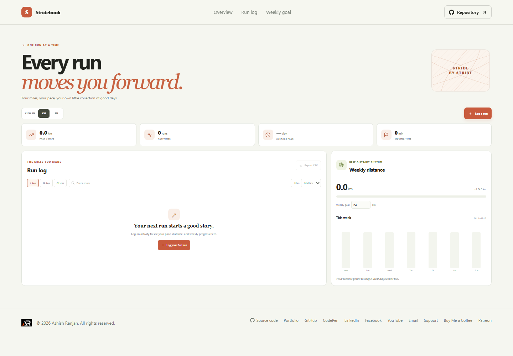

# Stridebook: Running Activity Log

Stridebook is a private place to record the miles you run, the time you spend moving, and the routes you want to remember. A clear weekly view makes it easy to notice the habit as it grows.

**Project repository:** https://github.com/a2rp/running-activity-log
**Deployed site:** https://a2rp.github.io/running-activity-log/

## What you can do

- Record a run with date, route name, distance, duration, effort, and a note.
- View distance, run count, and average pace across 7 days, 30 days, or all time.
- Review daily distance in a seven-day chart.
- Set a weekly distance goal and see progress toward it.
- Search and filter the run log and export visible results as CSV.
- Change between kilometers and miles for distance and pace display.
- Remove runs with a confirmation dialog.

## How to use it

Choose **Log a run**, enter the distance and moving time, and save the activity. The overview updates from your saved runs. Use the period filters and search to narrow the log, adjust the weekly goal to your own routine, or export the current list as a CSV file.

## Data and privacy

Run entries and the weekly distance goal are saved in local storage in this browser. They are not sent to a server. Clearing the browser's site data removes them. Stridebook does not use GPS or provide training or medical advice.

## Run and check locally

Install dependencies with `npm install`, then start the Vite development server with `npm run dev`. Run `npm run lint` for ESLint and `npm run build` for a production build. Run `npm run deploy` to publish the `dist` folder to the `gh-pages` branch.

## Future improvements

Ideas only. These are not implemented yet:

- Add optional route maps and elevation notes.
- Add goal reminders that can be configured by the user.
- Compare pace trends between similar distances.

## Links

- Portfolio: [https://www.ashishranjan.net](https://www.ashishranjan.net)
- GitHub: [https://github.com/a2rp](https://github.com/a2rp)
- CodePen: [https://codepen.io/ash1198](https://codepen.io/ash1198)
- LinkedIn: [https://www.linkedin.com/in/aashishranjan](https://www.linkedin.com/in/aashishranjan)
- Facebook: [https://www.facebook.com/theash.ashish/](https://www.facebook.com/theash.ashish/)
- YouTube: [https://www.youtube.com/@ashishranjan-ashz?sub_confirmation=1](https://www.youtube.com/@ashishranjan-ashz?sub_confirmation=1)
- Email: [mailto:ash.ranjan09@gmail.com](mailto:ash.ranjan09@gmail.com)

## Support

- Support: [https://a2rp-donation-page.netlify.app/](https://a2rp-donation-page.netlify.app/)
- Buy Me a Coffee: [https://buymeacoffee.com/ashishranjan](https://buymeacoffee.com/ashishranjan)
- Patreon: [https://www.patreon.com/ashishranjan](https://www.patreon.com/ashishranjan)